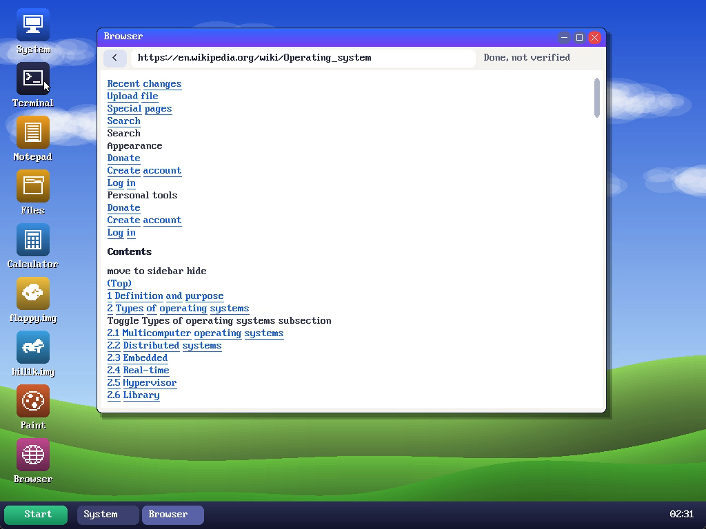

# XD OS

a desktop os in 19,456 bytes of x86 assembly. drag windows around, open a terminal, notepad, paint, files, a calculator, and a browser that does https. it also runs my flappy bird and hill climb boot sector games, the real .img files.



video: https://youtu.be/Xzv7CS0Fvnw

## run it

```
make run
```

on windows: `python tools/build.py`, then

```
qemu-system-i386 -drive format=raw,file=out/os.img -m 64 -vga std -rtc base=localtime -nic user,model=rtl8139
```

`python tools/test_all.py out` boots a copy and tests the apps.

## where stuff is

- `boot/boot.asm` boot sector and the decompressor
- `kernel/kernel.asm` desktop, windows, mouse, keyboard
- `kernel/apps/` the apps, browser has its own file
- `kernel/net/` rtl8139 driver, tcp/ip, tls 1.3
- `kernel/vm.inc` v86 mode, this is what runs the two games
- `tools/pack.py` the packer that gets it down to 38 sectors

## things to know

- the only network card it knows is the rtl8139, so keep `model=rtl8139`
- https doesn't check certificates, `curl` in the terminal wants `-k`
- 1024x768, 32 bit colour
